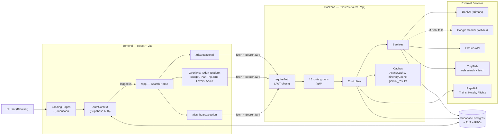
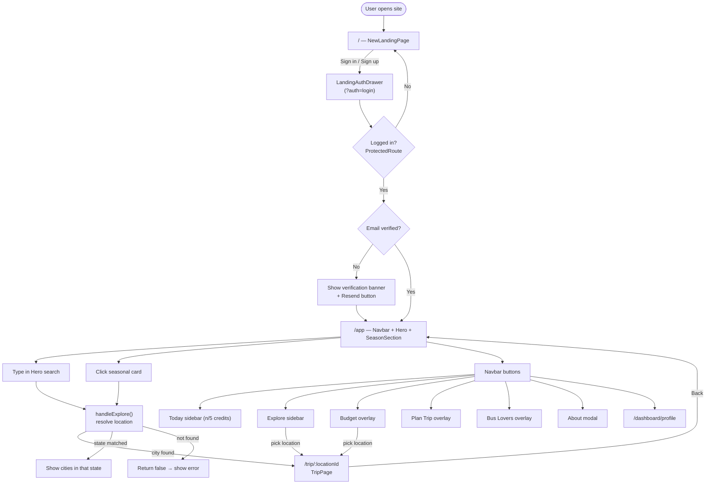
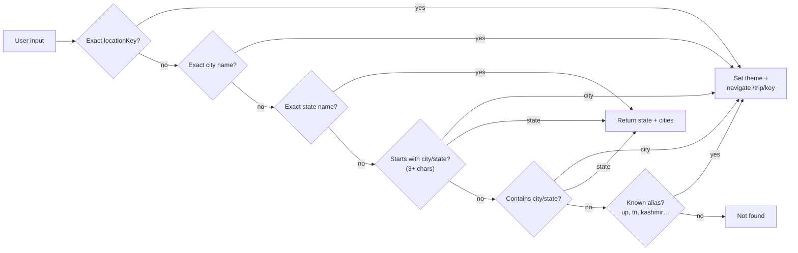
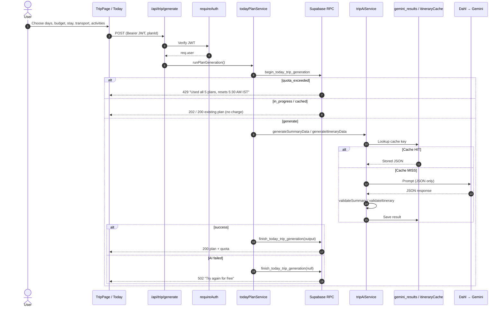
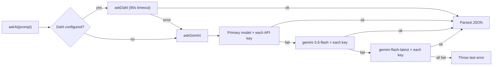
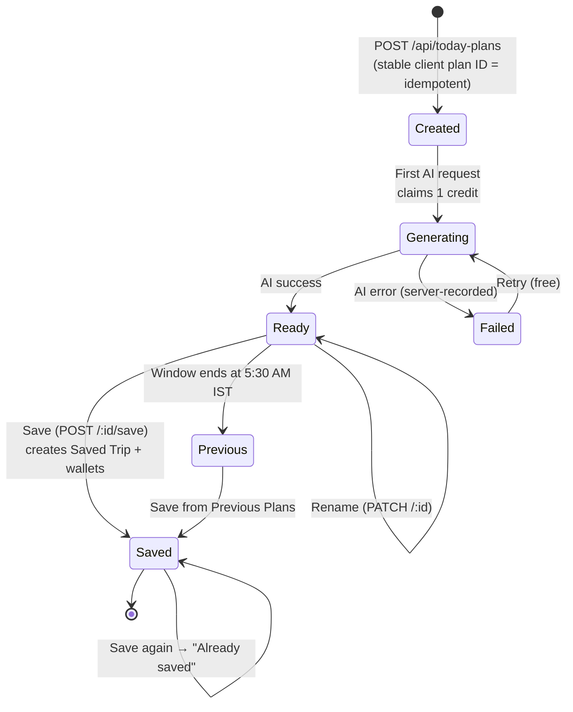
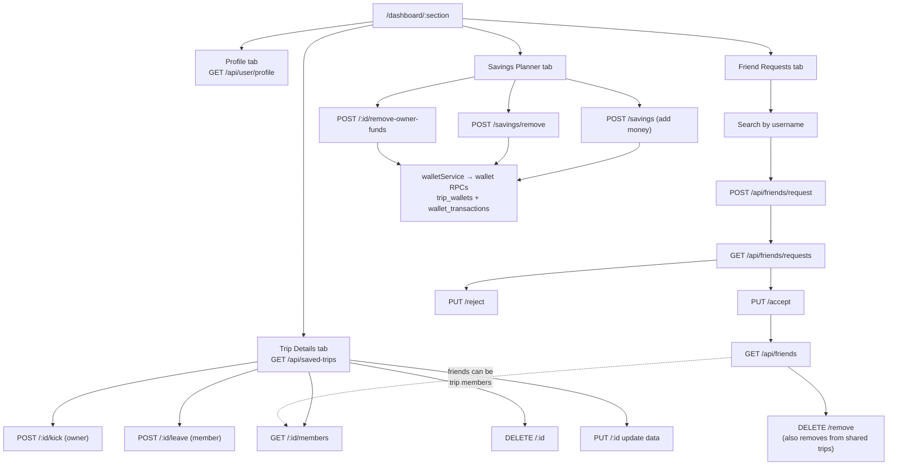
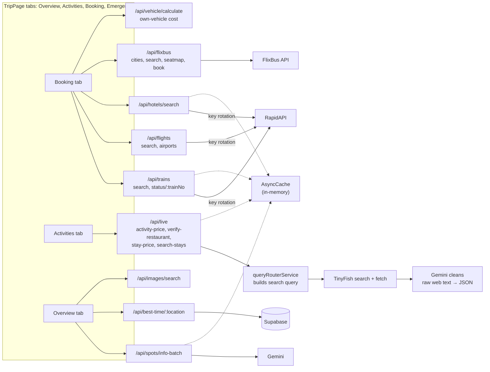
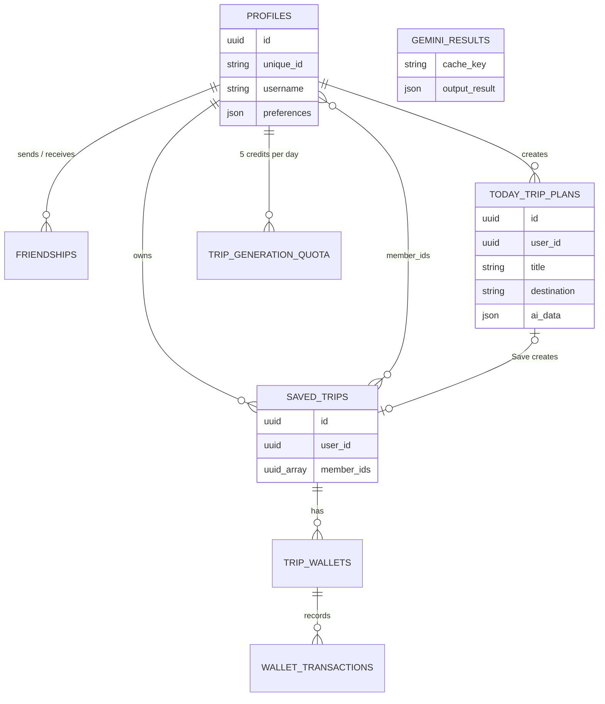

# Next-Stop — Project Workflow

Built from the real code: [App.jsx](file:///c:/Users/91928/trip-website/src/App.jsx), [Backend/index.js](file:///c:/Users/91928/trip-website/Backend/index.js), the `routes/`, `controllers/` and `services/` folders.

---

## 1. System Architecture (big picture)

**Deployment:** [api/index.js](file:///c:/Users/91928/trip-website/api/index.js) re-exports the Express app so Vercel runs it as a serverless function. Locally it listens on port `5000`.

---

## 2. Frontend Routing & User Journey

### Search resolution order (`handleExplore` in App.jsx)

---

## 3. AI Trip Generation (core flow)

This is the most important flow. A plan's **first** AI request uses 1 of 5 daily credits; repeats and retries after a server-side failure are free.

### AI provider fallback chain

---

## 4. Today Planning Desk — Plan Lifecycle

Planning window: **05:30 AM IST → next day 05:30 AM IST**, 5 credits per window.

---

## 5. Saved Trips, Wallets & Friends (Dashboard)

---

## 6. Live Data & Transport Lookups

---

## 7. Data Model (Supabase tables)

From the SQL files in [Backend/database](file:///c:/Users/91928/trip-website/Backend/database). Relationships are inferred from how the controllers query them.

---

## How the pieces connect — summary

| Layer | Main files | Job |
| :-- | :-- | :-- |
| Routing (FE) | `App.jsx` | Landing → auth → `/app`, `/trip`, `/dashboard` |
| Auth | `AuthContext.jsx`, `authMiddleware.js` | Supabase login in browser; JWT checked on the server |
| AI planning | `tripController` → `todayPlanService` → `tripAiService` | Credit claim, cache, Dahl/Gemini, validation |
| Today desk | `todayPlanController`, `TodaySidebar.jsx` | Daily plans, rename, save, history |
| Social + money | `savedTripController`, `friendController`, `walletService` | Group trips, friends, shared savings |
| Live data | `liveDataController`, `tinyfishService`, `queryRouterService` | Web search → AI cleanup → prices |
| Transport | train / flight / hotel / flixbus / vehicle controllers | RapidAPI + FlixBus with key rotation and caching |
